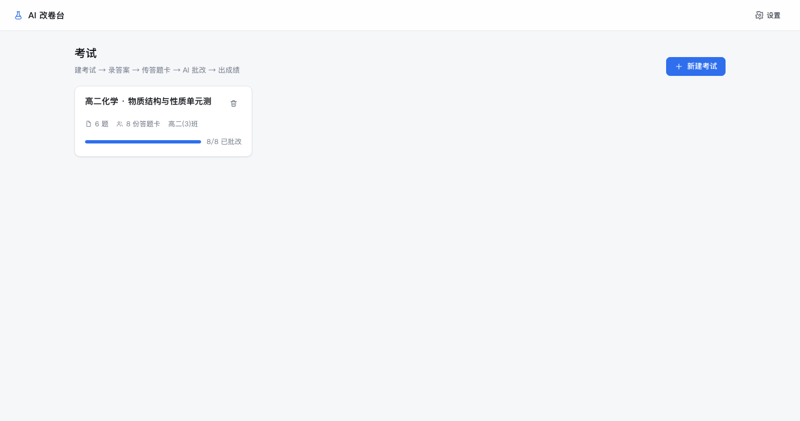
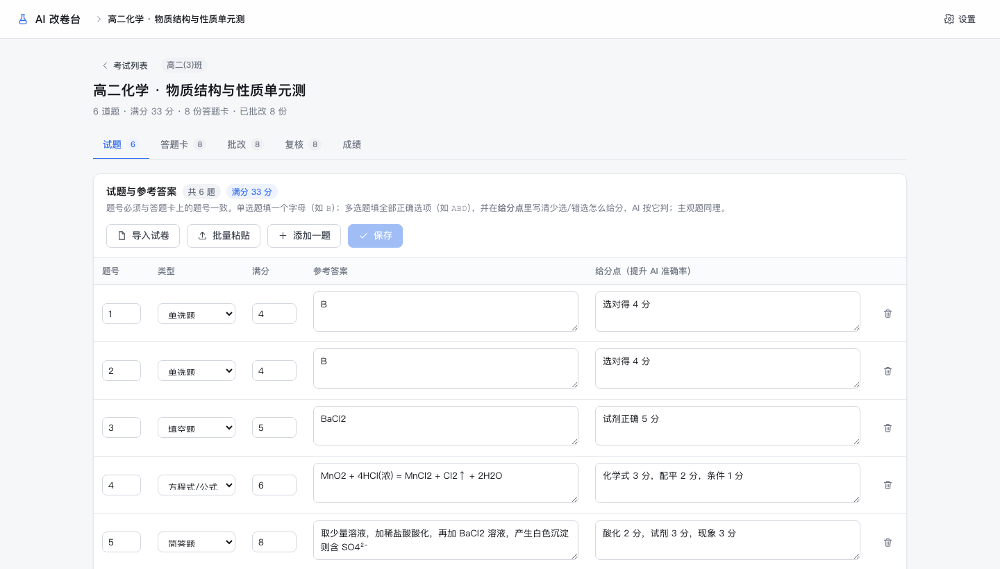
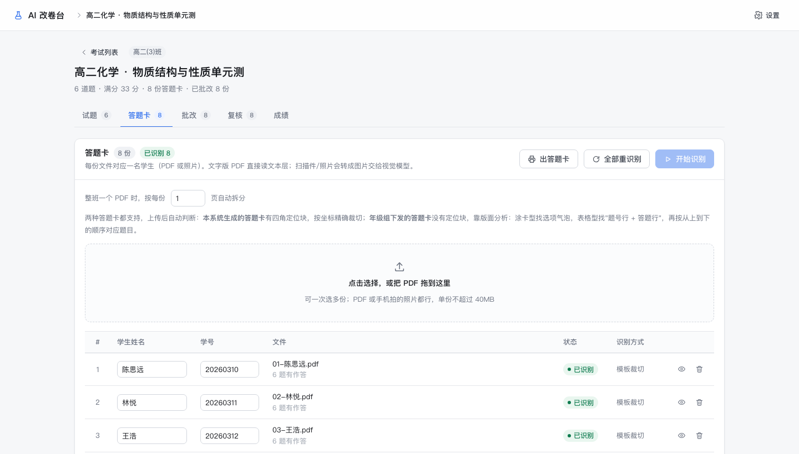
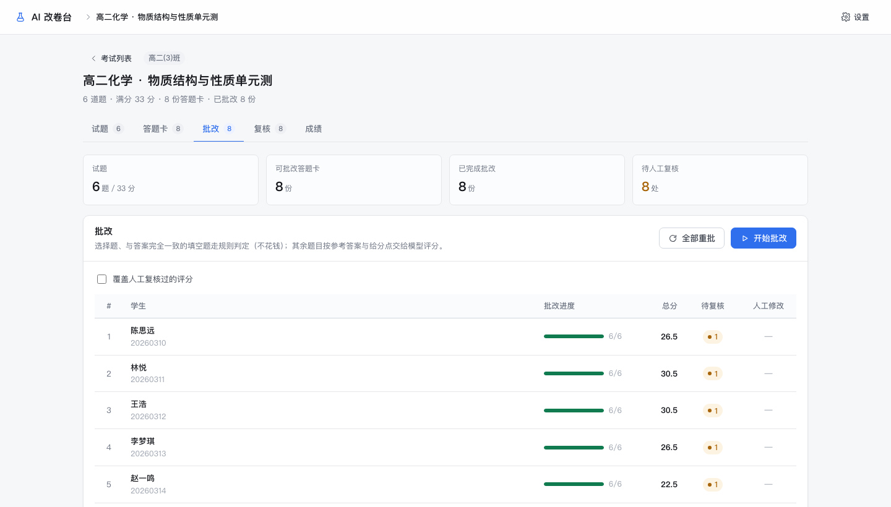
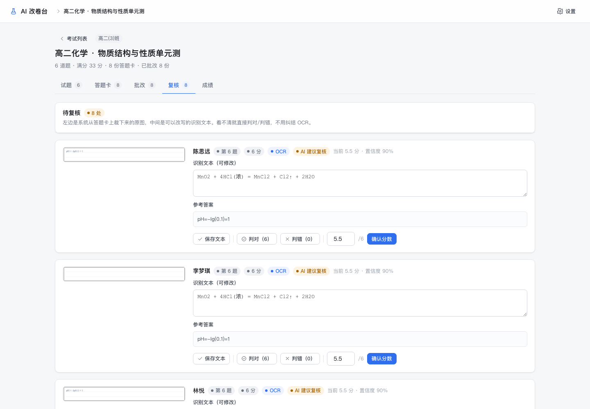
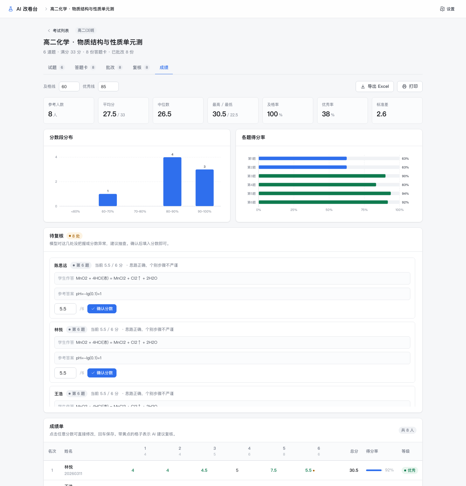
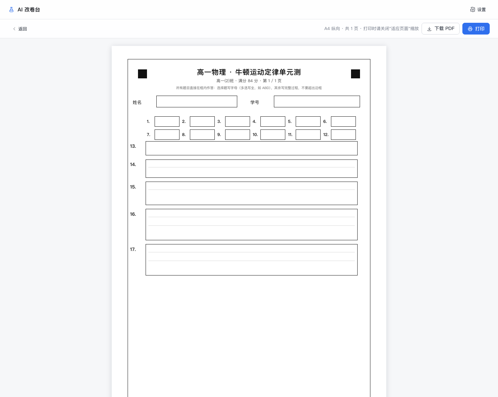

# AI 改卷台

给中学老师用的本地改卷工具：**自己出答题卡 → 扫描/拍照 → 自动裁切识别 → AI 评分 → 人工复核 → 导出 Excel**。

整套跑在自己电脑上，只有调用大模型时才联网；答题卡、成绩、裁切图都存在本地 `data/` 目录里。

支持任意学科（语文/数学/英语/物理/化学/生物/政史地……），学科只影响 AI 的评分口径。



---

## 它解决什么问题

老师手里通常有三种答题卡，这个工具都能处理：

| 答题卡来源 | 怎么定位 | 选择题怎么判 |
| --- | --- | --- |
| **本工具生成**（四角有定位块） | 定位块 + 透视校正，毫米级裁切 | 学生写字母，AI 读 |
| **年级组下发·涂卡型** | 版面分析找空心选项框 | 气泡涂墨判断（OMR，不花钱） |
| **年级组下发·表格型**（第一行题号，第二行写字母） | 投影法找表格横线 + 题号行 | 逐格裁切，AI 读字母 |

不用模板也能用，只是精度略低。

| 试题与答案 | 答题卡管理 |
| --- | --- |
|  |  |

| 批改 | 复核（看裁切原图直接判对错） |
| --- | --- |
|  |  |



---

## 工作流

```
① 试题     上传试卷自动提取，或手动录入
      ↓
② 出答题卡  生成 A4 PDF：四角定位块 + 选择题格 + 各题作答框
      ↓
③ 收答题卡  扫描 / 手机拍照（PDF、JPG、PNG 都行），整班一个文件也能自动按份拆分
      ↓
④ 自动处理  定位 → 透视校正 → 逐题裁切 → 拼图交给视觉模型转写
      ↓
⑤ 批改     单选题走规则（免费）；多选题、主观题交大模型按给分点判
      ↓
⑥ 复核     低置信度自动进队列：左边裁切原图，中间可改识别文字，右边判对/判错/给分
      ↓
⑦ 成绩     统计、图表、按学号排序导出 Excel（成绩单 / 分题明细 / 统计）
```



---

## 快速开始

前置：**Node.js ≥ 24**（用到内置 `node:sqlite` 和原生 TypeScript 直跑）。

```bash
npm install
npm run build
npm start
# 打开 http://127.0.0.1:8787
```

### 免安装包

不想装 Node 的话，直接从 Releases 下载：

- `paper-ai-win64.zip` — Windows x64，解压双击 `START.cmd`
- `paper-ai-mac-arm64.zip` — macOS Apple Silicon，解压双击 `START.command`

包里自带 Node 运行时和全部依赖，**不需要安装任何东西**。

---

## 配置模型

右上角「设置」→ 选服务商 → 填 Key。填完后失焦会自动拉取该服务商的可用模型列表，
模型框就是一个搜索框：有匹配直接选，没有匹配也能手填（按未公开模型使用）。

内置服务商：DeepSeek、OpenCode Go、智谱、Moonshot、通义千问、OpenAI、Ollama、自定义 OpenAI 兼容。

默认 DeepSeek `deepseek-flash`（V4.1 Flash）：一次调用同时支持文本和图片，便宜量大。
OpenCode Go 的话默认 `deepseek-v4.1-flash`，同样原生支持图片。

Key 存在本地 SQLite；也可以不落库，用环境变量：

```bash
cp .env.example .env      # 填 PAPER_AI_API_KEY
npm run start:env
```

---

## 上传试卷自动出题

「试题」页 → **导入试卷**：传试卷 PDF 或清晰照片，自动提取题号 / 题型 / 分值 / 参考答案，
填进表格给你确认后再保存。分值不确定的会先用 5 分占位并标黄。

- 文字版 PDF 走文本层，快且准；
- 扫描件/照片走视觉模型；
- 试卷末尾附答案的会一并带上；
- 大题带 (1)(2) 的拆成 `17-1`、`17-2`。

---

## 读题卡的分辨率预算

| 环节 | 上限 | 说明 |
| --- | --- | --- |
| 源图解码 | 长边 3200px | 手机 4000px 的照片会缩到这里（约 380dpi 等效），只缩不裁 |
| 单题裁切 | 1200px 宽 | 162mm 的作答框 ≈ 188dpi |
| 拼图 | 1280×1250 一张 | 低于模型 ~1300×1300 的缩图阈值，送进去不被二次压缩 |

题多时拼图会自动切成多张（20 题约 4 张），避免被模型整体缩小后看不清字。

常量都在 `server/crop.ts` 顶部，想调精度改那里。

---

## 数据与备份

```
data/
  paper-ai.db        SQLite（考试、题目、作答、评分、设置）
  uploads/           原始 PDF
  crops/<sheetId>/   逐题裁切图（复核页显示的就是它们）
```

整个 `data/` 目录拷走就是完整备份。**不要放在 OneDrive / iCloud 同步目录**，SQLite 的 WAL 会和同步冲突。

---

## 打包免安装版

```bash
npm run package:win    # → dist/paper-ai-win64.zip
npm run package:mac    # → dist/paper-ai-mac-arm64.zip
```

用 npm 的 `--os/--cpu` 交叉拉取目标平台的原生模块，内置官方 Node 运行时。
首次打包会下载运行时（约 95MB），之后走 `build/.runtime-cache/` 缓存。

需要 macOS / Linux 环境执行（依赖 curl、zip、tar）。

---

## 目录结构

```
server/
  main.ts          HTTP 服务 + 静态资源
  routes.ts        REST API
  db.ts            SQLite 数据层
  llm.ts           多厂商 OpenAI 兼容客户端（重试 / 超时 / 模型列表）
  pdf.ts           PDF 文本层抽取 + 页面渲染
  pdfSplit.ts      整班 PDF 按页拆分
  template.ts      答题卡版式计算（前后端共用毫米坐标）
  renderSheet.ts   答题卡渲染成 PDF（canvas，不依赖 PDF 库）
  crop.ts          定位块检测 / 单应性变换 / 裁切 / 涂卡识别
  cropOcr.ts       裁切图拼图 + 交模型转写（前缀可缓存）
  generic.ts       无定位块答题卡的版面分析
  paperImport.ts   试卷 → 题目
  excel.ts         Excel 导出（三个工作表）
  pipeline.ts      识别与批改管线
  jobs.ts          任务队列 + SSE 进度
web/               React + Vite（无 UI 框架，手写 SVG 图标与图表）
shared/types.ts    前后端共享类型
scripts/           启动器、自检、演示数据、mock 模型、打包
```

---

## 常用命令

| 命令 | 作用 |
| --- | --- |
| `npm start` | 启动服务 |
| `npm run dev` | 开发模式（API + Vite 热更新） |
| `npm run build` | 构建前端 |
| `npm run check` | 环境自检 |
| `npm run typecheck` | 类型检查 |
| `npm run mock` | 启动假模型（无需 Key） |
| `npm run seed` | 造一套演示数据（需先跑 `npm run mock`） |
| `npm run diagnose -- 扫描件.pdf` | 验证四角定位，输出 overlay 图 |

---

## 已知限制

- 手写体识别依赖视觉模型，会出错，所以"低置信度必进复核"是刻意设计。
- 选择题（单选/多选）不进入人工复核队列，读错只能在成绩页点分数改。
- 裁切只带 0.8mm 余量，学生写到框外的内容会被切掉。
- 表格型答题卡若题号与当前考试不一致，会提示"数量与题目不符"并标记复核。
- 服务只监听本机，没有登录鉴权，适合单机单老师使用。

---

## License

MIT
